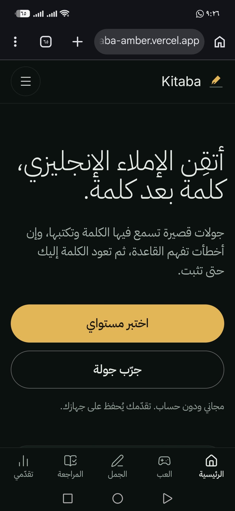
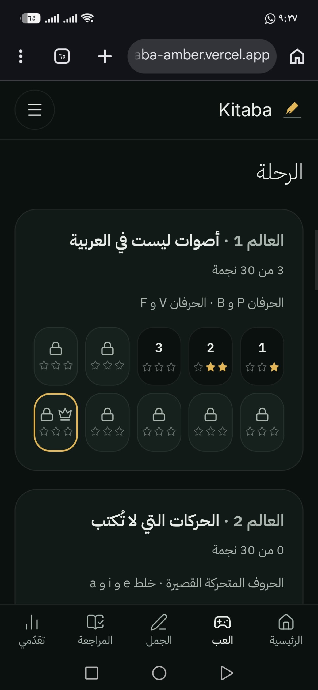
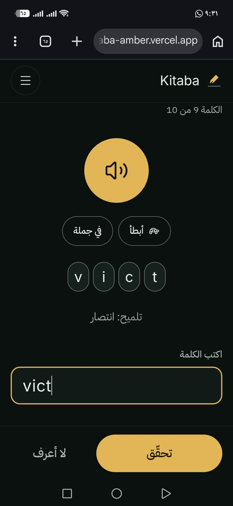
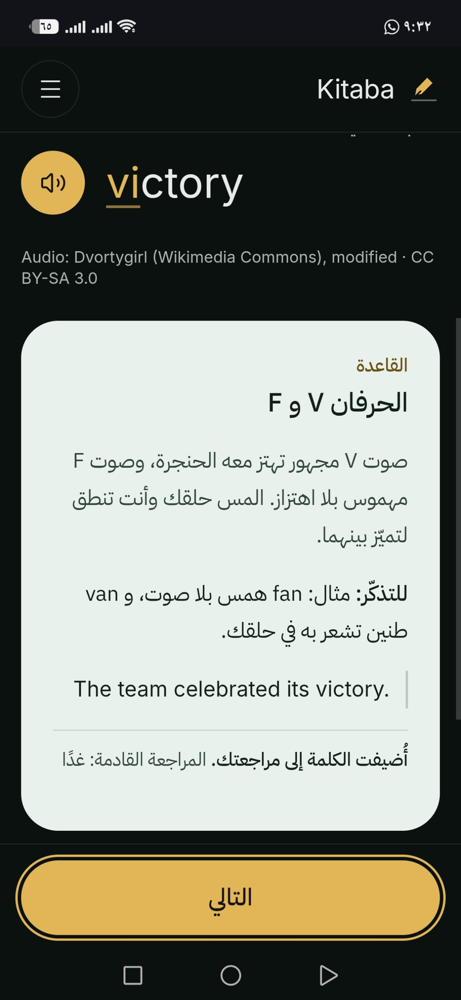
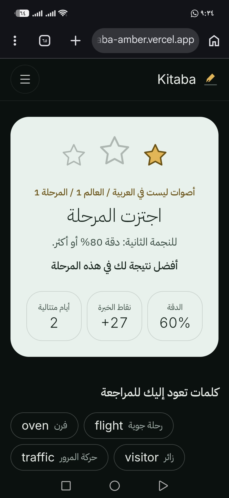
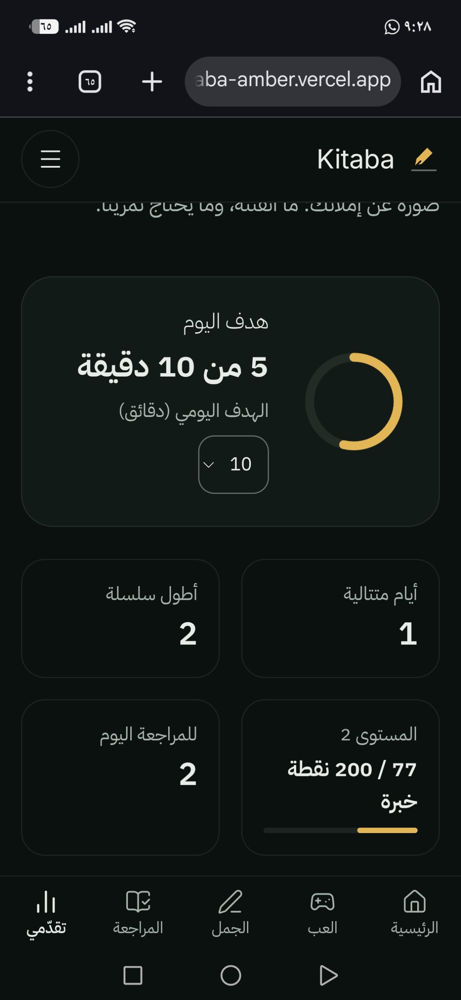
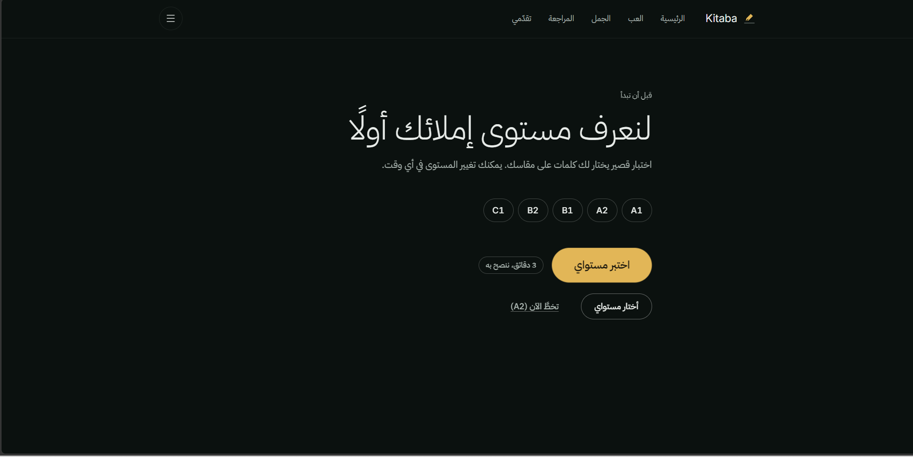
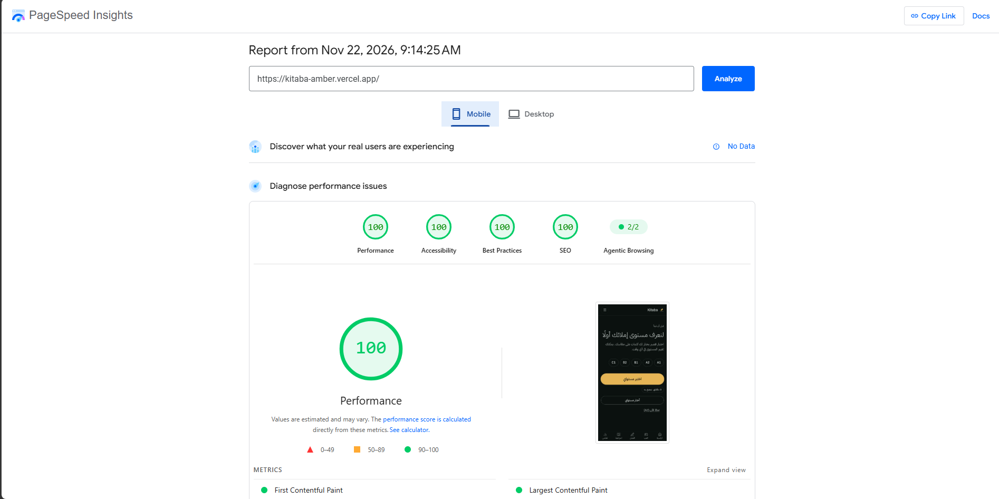
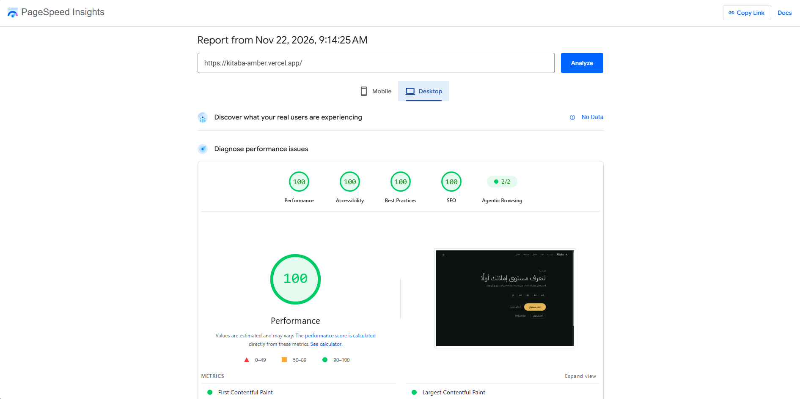

# Kitaba

**English spelling practice built for Arabic speakers: short games, instant feedback that names the rule, and spaced repetition for your own mistakes.**

**Live:** <https://kitaba-amber.vercel.app>

[](https://nextjs.org/)
[](https://www.typescriptlang.org/)
[](https://supabase.com/)
[](#quality)
[](#quality)

<table>
  <tr>
    <td align="center"><br><sub>Home</sub></td>
    <td align="center"><br><sub>Campaign worlds</sub></td>
    <td align="center"><br><sub>Listen and Spell</sub></td>
  </tr>
  <tr>
    <td align="center"><br><sub>Feedback with the rule</sub></td>
    <td align="center"><br><sub>Stage result</sub></td>
    <td align="center"><br><sub>Progress</sub></td>
  </tr>
  <tr>
    <td colspan="3" align="center"><br><sub>Desktop: first-visit level choice and placement test</sub></td>
  </tr>
</table>

## Features

- **Seven game modes:** Listen and Spell, Spelling Bee (60 seconds, combo multiplier), Fix the Mistake, Missing Letters, Word Scramble, Pick the Right Spelling, and Review.
- **Campaign:** 8 worlds × 10 stages, 1–3 stars per stage, unlocks, a boss stage per world (mixed modes and dictated sentences), and a daily challenge.
- **Feedback that teaches:** after a mistake the learner sees the correct spelling, their own answer with the differences marked letter by letter, and the rule in one line of Arabic.
- **Spaced repetition:** every missed word goes into an SM-2 review queue and comes back when it is due.
- **Sentences and messages:** dictation of whole sentences and longer messages with a word-by-word comparison, plus free writing for an Arabic scenario, spell-checked on the device.
- **Levels A1–C1:** choose a level, take a short adaptive placement test, or skip and start at A2. Word, sentence and test levels can be changed at any time.
- **Pronunciation:** a short MP3 per game word, with American or British English for both the voice and the expected spelling. Words without a file fall back to the device's voice.
- **Motivation:** XP and levels, streaks, a daily goal, achievements, stats on the weakest categories, and an opt-in weekly leaderboard.
- **Guest-first and offline:** everything works with no account and offline after the first visit. An optional account adds sync across devices.
- **No analytics, no tracking, no AI APIs.** The only network calls go to Supabase, and only when it is configured.

## Built for Arabic speakers

- **The curriculum follows the mistakes Arabic speakers make.** World 1 is *Sounds Arabic doesn't have* (p/b, v/f). World 2 is *The vowels Arabic leaves out* (short vowels, e/i/a confusion). Later worlds cover double and silent letters, word endings, ie/ei, prefixes and suffixes, British vs American spelling and homophones.
- **Arabic first, right to left.** The interface is Arabic by default with an English toggle. Rule explanations are written in Arabic, and Western digits are used in both languages.
- **Every word has an Arabic meaning hint.** The 1,591 hand-written words in 15 categories each have an Arabic hint and an example sentence, written for this project.
- **Built for phones.** Learners study in short sessions on a phone, so the keyboard stays open between words, a timer starts on the first keystroke, and the layout, text size, reading-friendly font and reduced-motion options are tuned for that.

## Tech stack

| Layer | Choice |
|---|---|
| Framework | Next.js 16 (App Router, prerendered pages with Cache Components), React 19 |
| Language | TypeScript (strict) |
| UI | Tailwind CSS 4, shadcn/ui on Radix, `motion` (respects reduced motion), lucide-react |
| Local data | Dexie 4 (IndexedDB) with versioned migrations |
| Validation | zod 4 |
| Spell check | `nspell` with `dictionary-en` (SCOWL), run on the device |
| Backend (optional) | Supabase: Postgres with row-level security, Auth (Google and email, each behind a flag) |
| Tests | Vitest with `fake-indexeddb` |
| Hosting | Vercel |

## Architecture

- **Local-first, with optional sync.** Progress is written to IndexedDB first and the UI never waits on the network. When a learner signs in, an outbox pushes local changes to Supabase and pulls remote ones using a server-clock cursor, with last-write-wins merging. On the first sign-in, existing guest progress can be merged into the account.
- **Repository interfaces.** The UI and domain code depend on typed interfaces (`src/repositories/types.ts`: words, games, mastery, achievements, profile, writing, leaderboard and so on). Behind them sit a Dexie store, an in-memory store for tests, and a Supabase store, chosen at runtime.
- **Pure domain layer.** The game engine, answer checking (US/UK variants), letter diff, misspelling generator, campaign rules and SM-2 scheduler are plain TypeScript in `src/domain`, with no React and no I/O, so they are unit-tested directly.
- **Lazy-loaded content and audio.** The hand-written word bank ships with the app. A larger open-data library of graded words and Tatoeba sentences lives in content-hashed JSON files in `public/content/v1` and is fetched only when needed. Pronunciation MP3s in `public/audio/v1` are loaded per word. The Supabase client, the spell checker and the licence notices are kept off the pages that do not use them, and `npm run check:bundle` enforces a first-load JS budget.
- **PWA.** It is installable, and a service worker (production builds only) caches the app shell, the open-data library and the audio for offline play. The app-shell cache is named per build, so it is replaced on each deploy, while the content-hashed data and audio caches are kept. Settings can download the full library for offline use.

```
src/app            thin routes
src/features       React features (games, writing, levels, account, leaderboard, ...)
src/domain         pure TypeScript: engine, spelling, campaign, SRS, sync rules
src/repositories   interfaces + Dexie, in-memory and Supabase backends, outbox
src/data           hand-written content, rules, schemas, validator
scripts/           open-data and audio pipelines, CSP hashing, bundle report
supabase/          SQL migrations and RLS tests
tests/             Vitest suites
```

## Security

- **Row-level security on every table.** Users can read only their own rows. All writes go through `SECURITY DEFINER` functions that only ever touch `auth.uid()` and pin `search_path`. Clients have no direct insert or update grant. `supabase/tests/rls_tests.sql` checks this, including that a direct `UPDATE` is refused.
- **Only the public anon key in the client.** No `service_role` key or OAuth secret is in the repo or the browser. Account deletion uses a function that can delete only the caller.
- **Content-Security-Policy by script hash.** Every page gets a strict CSP. After the build, `scripts/csp-hashes.mjs` adds the SHA-256 hash of each inline script to every prerendered page, so there is no `'unsafe-inline'` for scripts and pages stay static. There are also HSTS, `X-Frame-Options: DENY`, `nosniff`, a referrer policy and a restrictive permissions policy.
- **Rate limits and abuse limits.** Leaderboard scores are limited to one per 20 seconds and 30 per rolling day, with plausibility checks and a per-user lock. Synced data has per-record and per-user storage quotas kept by a counter trigger. Nicknames are normalised (including Arabic tatweel and letter variants) before the profanity filter runs.
- **Safe redirects.** Auth callbacks only redirect to paths on the same site.
- **Security review.** A full-codebase security review on 2026-11-22 found no critical or high issues. The medium and low findings were fixed and are documented in [DECISIONS.md, "Security hardening"](DECISIONS.md#security-hardening-security-review-2026-11-22). The one remaining item is a moderate advisory in a dev-only CLI dependency.

## Quality

- **706 automated tests in 64 files** (Vitest): the domain logic, the repositories and Dexie migrations, sync and merging, auth redirects, the CSP, and content validation (schema, duplicates, stage pools, open-data hashes, credits, blocklist, and a clean spell check of every sentence).
- **Lighthouse 100 on mobile and desktop** for Performance, Accessibility, Best Practices and SEO (PageSpeed Insights, 2026-11-22):

| Mobile | Desktop |
|---|---|
|  |  |

- Strict TypeScript (`npm run typecheck`), ESLint, and a bundle-size report after each build.

## Open data and audio credits

All 1,591 core words, Arabic hints, example sentences and rule texts were written for this project. The larger library and the audio build on open data:

| Source | Used for | Licence |
|---|---|---|
| [Tatoeba](https://tatoeba.org/) | Dictation and example sentences (filtered and normalised) | CC BY 2.0 FR, each sentence's author credited |
| [Wikimedia Commons](https://commons.wikimedia.org/) (incl. Lingua Libre) | Human pronunciation recordings (trimmed, normalised, converted to MP3) | Per file: mostly CC BY-SA 3.0/4.0, some CC BY and CC0 |
| [Piper](https://github.com/rhasspy/piper) `en_US-ljspeech-high` voice | Generated pronunciation where no recording exists | Public domain |
| [SCOWL](http://wordlist.aspell.net/) and [VarCon](http://wordlist.aspell.net/varcon/) | Word frequency tiers, American/British pairs | Permissive (MIT-like, BSD notices) |
| [dictionary-en](https://github.com/wooorm/dictionaries) | On-device spell check | MIT and SCOWL |
| [CMU Pronouncing Dictionary](https://github.com/cmusphinx/cmudict) | Homophone detection and silent-letter hints (not shipped) | BSD-2-Clause-style |

- Full credits, reproduced notices and the Tatoeba author list are on the **[credits page](https://kitaba-amber.vercel.app/credits)**.
- Every audio file, with its author, source page, licence and changes, is listed in the `audio-credits.*.tsv` file in **[`public/audio/v1/`](public/audio/v1/)**, which is also downloadable from the credits page. The Tatoeba author list is the `tatoeba-credits.*.tsv` file in [`public/content/v1/`](public/content/v1/).
- Modified CC BY-SA recordings are shared under the same licence as their originals.

## Run locally

Requires Node.js 20.9 or later.

```bash
npm install
npm run dev          # http://localhost:3000
```

The app runs fully in guest mode with no configuration. Other commands:

```bash
npm test             # Vitest
npm run typecheck    # tsc --noEmit
npm run lint         # ESLint
npm run build        # production build + CSP hashes (deploy with this, not plain `next build`)
npm run check:bundle # after a build: first-load JS budget
```

Supabase setup, the Google sign-in guide, the content and audio pipelines and the source layout are in **[docs/DEVELOPMENT.md](docs/DEVELOPMENT.md)**. The product spec, design notes and full decision log are in [SPEC.md](SPEC.md), [DESIGN.md](DESIGN.md) and [DECISIONS.md](DECISIONS.md).

### Environment variables

All are optional. Copy `.env.example` to `.env.local`. Only public values are used, and no secrets belong in any `.env` file.

| Name | Purpose |
|---|---|
| `NEXT_PUBLIC_SUPABASE_URL` | Supabase project URL (enables accounts, sync and the leaderboard) |
| `NEXT_PUBLIC_SUPABASE_ANON_KEY` | Supabase public anon key |
| `NEXT_PUBLIC_ENABLE_GOOGLE_SIGNIN` | `true` to show Google sign-in (off by default) |
| `NEXT_PUBLIC_ENABLE_EMAIL_SIGNIN` | `true` to show email sign-in (off by default) |
| `KITABA_BUILD_STAMP` | Optional fixed service-worker cache name; defaults to the build time |

## Licence

- **Code:** [MIT](LICENSE).
- **Original learning content** (the hand-written words, Arabic hints, example sentences and rule texts): [CC BY-SA 4.0](https://creativecommons.org/licenses/by-sa/4.0/).
- **Third-party data and audio** keep their own licences, as listed above, in the credit files and on the [credits page](https://kitaba-amber.vercel.app/credits).

[LICENSE](LICENSE) lists which folders each licence applies to.

## How it was built

Built with AI-assisted development (Claude Code), designed and tested by me.

---

## بالعربية

**Kitaba** تطبيق مجاني لتعلّم الإملاء الإنجليزي، صُمّم للناطقين بالعربية من المستوى A1 إلى C1. تسمع الكلمة وتكتبها في جولات قصيرة، وإن أخطأت ترى الحروف التي أخطأت فيها والقاعدة بجملة واحدة بالعربية، ثم تعود إليك الكلمة للمراجعة في وقتها (التكرار المتباعد).

- سبعة أنماط لعب، و8 عوالم في كل منها 10 مراحل، وتحدٍّ يومي، وإملاء جمل ورسائل كاملة.
- المنهج مبني على أخطاء الناطقين بالعربية: أصوات ليست في العربية (p/b وv/f)، والحركات التي لا تُكتب، والحروف المضاعفة والصامتة، وغيرها.
- لكل كلمة معنى بالعربية وجملة مثال، ونطق بلكنة أمريكية أو بريطانية.
- يعمل دون حساب ودون إنترنت بعد الزيارة الأولى، ويُحفظ التقدّم على جهازك. الحساب اختياري للمزامنة بين الأجهزة.
- لا إعلانات ولا تتبّع ولا ذكاء اصطناعي داخل التطبيق.

جرّبه الآن: <https://kitaba-amber.vercel.app>
